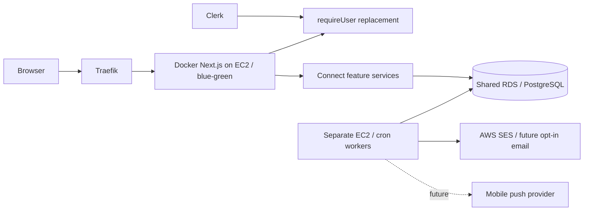

# Connect Internationals — design for Maxi

## What this prototype establishes

Students can discover peers, request a connection, chat after acceptance, join
three circles and share invitation links. Connecting is free for every account;
FREE and PAID receive identical permissions and abuse limits. There is no Stripe
integration. This local compatibility prototype does not establish student demand.

The import contains 925 supplied pseudonymous records. Supplied names and emails
are not stored; cards use editable Demo aliases. University, major, interests,
purposes and skill tags are deterministic synthetic examples. Field provenance
separates supplied, synthetic and user-entered information. Consent and newcomer
activation are explicitly simulated. Neither fake names nor generated academics
or interests validate compatibility, real consent, registrations or growth.
Production needs fresh, informed student choices rather than importing demo opt-ins.

## Discovery, ranking and sparse data

Discovery combines exact filters with at most five explained suggestions. Browse
pages default to 12 cards, capped at 20; there is no total count. Filters combine
with AND and never silently broaden. Cards show an alias, purposes, interests,
needs/offers, permitted background, synthetic labels and relationship actions.
Empty results explain that no eligible profiles can be shown. Unknown data stays unknown.

Normalization trims values and maps missing/withheld answers to null. The explicit
city aliases NYC, New York City, New York City, NY and New York, NY resolve to
New York, NY. Ambiguous city names remain unchanged: guessing a location would
create false matches. Tags are normalized and deduplicated. Production should ask students to confirm canonical values.

Ranking is deterministic, calculated after privacy projection. Shared purposes
score 5 each, capped at 10; interests 3 each, capped at 9; complementary needs and
offers 5 per distinct tag, capped at 10. Matching disclosed city, university and
major add 3, 2 and 2. Nationality adds 1 only when the viewer explicitly enables
that preference; it is off by default. User IDs break ties.
Positive scores produce up to three strongest accurate reasons, including the
correct direction of help. Hidden fields never contribute reasons or scores.
These are understandable heuristics, not compatibility percentages. Production
should evaluate usefulness and exclusion with consenting students before tuning.

## Introductions and messaging

A student chooses a purpose and writes a 1–300-character introduction. Only the
recipient accepts or declines; only the sender cancels. Messaging opens after
acceptance. Compared with unrestricted DMs, this adds friction but gives recipients
a meaningful choice without revealing an email address. Declined, cancelled and
closed pairs cannot restart in this prototype; production needs an explicit,
safety-reviewed policy before offering resets.

Canonical unordered-pair uniqueness prevents duplicate/crossed requests. Ordered
User-row locks and transactions serialize eligibility, usage and transitions;
concurrent acceptance yields one conversation. The server enforces five
introductions per rolling 24 hours, 20 pending introductions and 30 messages per
rolling minute. Cancellation does not refund usage. Accepted participants alone
can read/send; every operation rechecks deletion, blocks and relationship state.
Messages are PostgreSQL text, capped at 2,000 characters, rendered as text, with
stable timestamp/ID cursor pagination. Ordinary discovery opt-out preserves an
accepted chat; blocking closes it.

Only the active conversation polls approximately every five seconds. Navigation,
identity changes and safety actions abort requests and clear timers/state. Polling
fits a small team and one EC2 instance, at the cost of latency and repeated reads.
SSE could improve server-to-client delivery while retaining HTTP sends, but needs
reconnection and proxy handling. WebSockets add bidirectional connections and
cross-instance coordination; managed realtime adds vendor cost and integration.
None is implemented; first measure polling load and user needs.

## Privacy and safety

Ordinary discovery requires opt-in. The editor previews what strangers may see;
alias, purposes and tags accompany opt-in, while nationality, city, university and
major each require separate sharing. No visa status, photos or emails are exposed.
A shared server privacy service excludes self, hidden/deleted profiles and either
side of a block before lists, direct lookup, filters, counts and ranking. Routes
return allowlisted DTOs, never raw Prisma records, and personal responses are
private/no-store. Cookie identity is validated on every request; mutations check
origin and stale-persona identity. The demo cookie is deliberate impersonation,
not secure authentication; production must replace it.

Visible demographic tuples require at least five eligible peers, otherwise all
background fields are stripped. Filtering reapplies the policy; demographic
results below five are suppressed. Circle lists use the same projections and
coarse member bands, withheld below five. This reduces identification but is not
anonymity: aliases, tags, repeated queries and enumerable members can still reveal
membership. Production needs privacy review, query-abuse controls and observation
of small-cohort inference before release.

Blocking denies both directions, closes active relationships and permanently
excludes affected old invitation permissions. Unblocking restores neither chats
nor permissions. Reports accept five validated reasons, limited context and five
submissions per rolling day. Confirmation says recorded locally, no human team
is monitoring, and reporting does not auto-block. Production needs a designated
Northbridge Trust & Safety owner, restricted review queue, audited access,
escalation and response expectations. Proposed context expiry is 30 days unless
a reviewed case requires retention; neither staffing nor retention jobs exists.

Deletion requires two acknowledgements and a typed phrase. It purges the profile,
memberships, owned invitations/dependent claims, own referral, blocks, reports,
usage and affected requests/conversations/messages for both participants. Only
User ID and a deletion marker remain for that account; reseeding cannot restore
it. The ignored source file and external copies remain. Deletion locks all local
User rows in consistent order to prevent races. This simple, atomic local choice
limits throughput; production needs narrower account-lifecycle serialization and
an explicit backups/retention policy. Previously viewed content cannot be recalled.

## Circles, invitations and storage

SWE Interview Partners, Campus & City Friends and Project Builders have purposes
and proposed starter activities. Membership is voluntary and unique; no group chat
or fabricated members/activity is supplied. Joining does not create friendships.
Links use random 256-bit tokens, stored only as hashes, expire after seven days
and support creator revocation. A public landing exposes only explicitly approved
alias/message/permission and a public circle summary. Tokens never authenticate
the visitor as the creator. A reserved newcomer explicitly activates a simulation,
then separately introduces themselves; the inviter still accepts. Circle joining
is another action. Claims are idempotent and allow only one source per newcomer;
visits are not registrations. Token-scoped consent never opens directory access.

Prisma keeps feature fields out of User. ConnectProfile and ProfileDeletion are
keyed by userId. ConnectionRequest has unique canonical pair columns;
Conversation has a unique request; Message indexes conversation/time/ID for stable
history. Block and CircleMembership have unique directed-pair/member keys.
Invitation has a unique token hash, ReferralClaim a unique newcomer, and
InvitationRestriction a unique link/visitor exclusion. Report and UsageCounter
support safety and rolling windows. Foreign keys, lookup indexes and array GIN
indexes support the current access paths. Four checked-in migrations preserve
existing records. Queries live in repositories, policy in services and HTTP
handlers authenticate/validate. Scale work includes query plans, bounded projection and narrower locks.

## Proposed fit in Northbridge production

The following adapts Maxi's existing architecture; no AWS resources or credentials
were provisioned. Clerk would replace requireUser() while service permissions stay.

The app handles interactive authorization, discovery, transitions and persistence.
Workers would handle cleanup and deliberately opted-in notifications through an
outbox with retries/deduplication, rechecking deletion/blocks/preferences before
sending. Avoid nationality-targeted digests by default and keep email content
minimal. SES delivery/bounce/complaint handling needs operational ownership
([SES documentation](https://docs.aws.amazon.com/ses/latest/dg/send-email-concepts-process.html)).
Use private networking, least privilege and managed backups with shared
[RDS PostgreSQL](https://docs.aws.amazon.com/AmazonRDS/latest/UserGuide/CHAP_PostgreSQL.html).
Future mobile push needs device consent and revocation, not another identity model.

## City-level map and deployment boundary

A map is proposed, not built. Aggregate only consenting, eligible city-sharing
profiles into city-centre circles; suppress groups below five and avoid exact
counts, individual pins, precise coordinates or nationality drill-downs. Prefer
coarse bands and a list alternative. Never infer residence or geolocate students.
[Leaflet](https://leafletjs.com/) is open source; tile hosting and geocoding are
separate services with attribution, usage and possible costs. The public
[OSM tile policy](https://operations.osmfoundation.org/policies/tiles/) is not an
unlimited free hosting promise. Choose a compliant provider/budget and a curated
city-centre catalogue; no geocoding or map API runs in this prototype.

The pinned compatibility stack needs replacement before deployment:
[Next.js 14 is unsupported](https://nextjs.org/support-policy) and
[Node 20 is EOL](https://nodejs.org/en/about/eol). The last clean install reported
11 audit findings. Upgrade to supported versions, reassess dependencies and rerun
security/privacy/concurrency tests before any real-user deployment.
